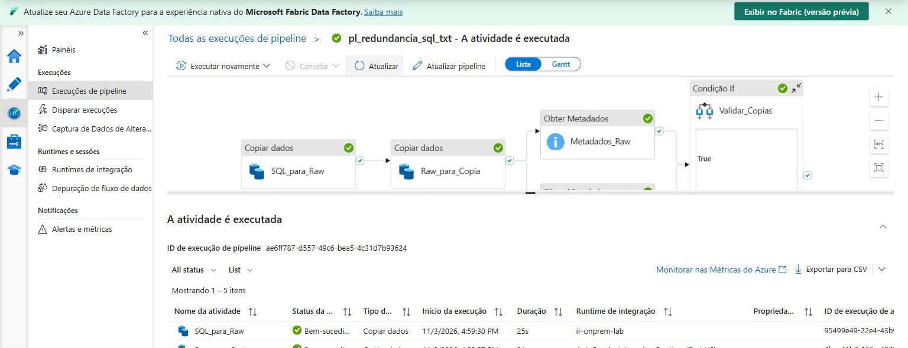
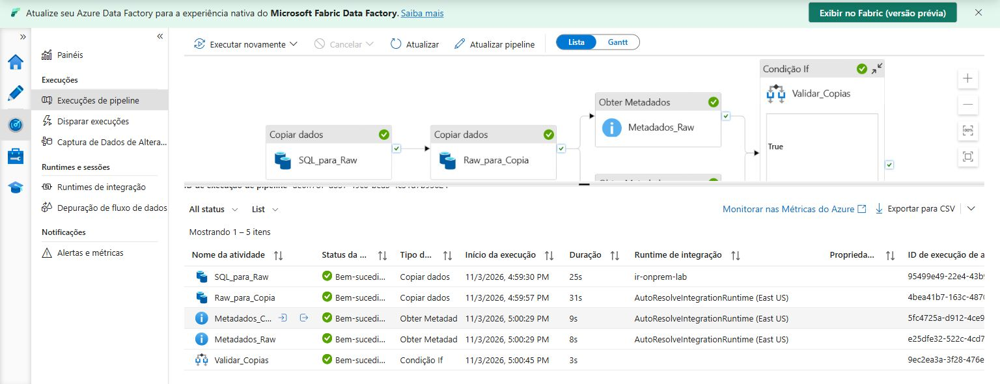
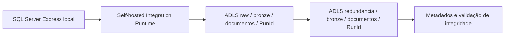
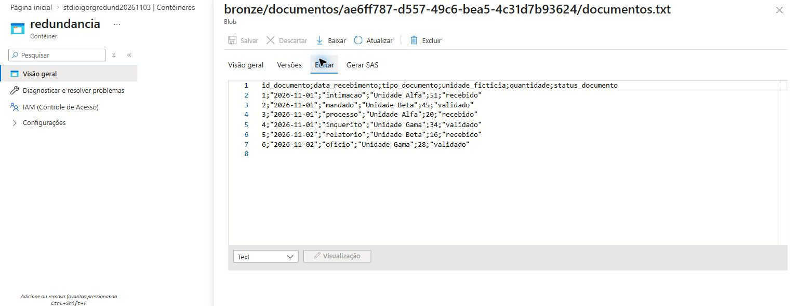
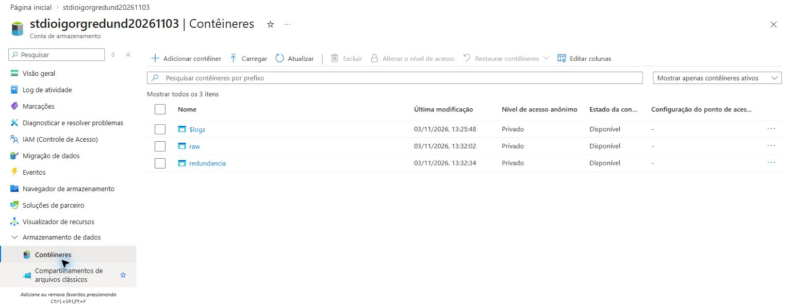
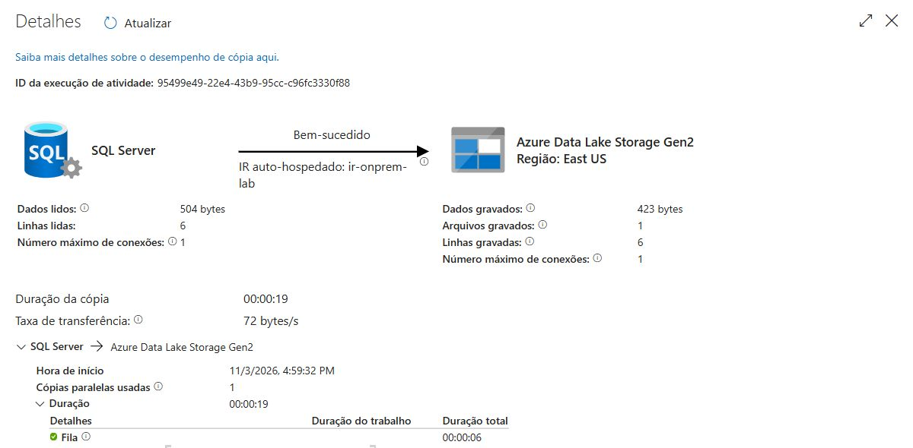

# Redundância de arquivos com Azure Data Factory

Laboratório do desafio DIO **Criando Processos de Redundância de Arquivos na Azure**. Usa somente dados sintéticos e demonstra ingestão de SQL Server local para TXT no Azure Data Lake Storage Gen2, seguida de uma segunda cópia e validação.

**Executado e validado no Azure em 3 de novembro de 2026.** O pipeline terminou com sucesso em 1 minuto e 27 segundos. Foram exportados 6 registros para um TXT de 423 bytes; a segunda cópia preservou todos os bytes. A comparação com a referência também foi aprovada, com quantidade total de 194. Consulte [o registro de execução](docs/estado-execucao.md) e [o resultado da validação](docs/validacao-arquivos.json).





## Arquitetura



O Data Factory orquestra as atividades. O runtime instalado no PC movimenta os dados. Uma identidade gerenciada acessa exclusivamente a conta de armazenamento do laboratório; nenhuma chave de armazenamento é versionada.

## Dados e organização

- Tabela fictícia: `DioRedundanciaLab.dbo.DocumentosFicticios`.
- Referência: 6 registros; soma de `quantidade` igual a 194.
- Saída: `documentos.txt`, delimitador `;`, UTF-8 e cabeçalho.
- Cada execução usa seu próprio `RunId` na pasta, evitando misturar execuções distintas.
- A segunda cópia usa formato binário para preservar os bytes do arquivo original.

## Reprodução

1. Instale SQL Server Express e Self-hosted Integration Runtime a partir das fontes oficiais da Microsoft.
2. Execute [sql/01_criar_base.sql](sql/01_criar_base.sql) em uma instância dedicada ao laboratório. O script não apaga dados existentes.
3. Registre o runtime `ir-onprem-lab` no Data Factory. Mantenha a chave de registro fora do Git.
4. Crie uma conta Standard LRS com namespace hierárquico e dois contêineres privados: `raw` e `redundancia`.
5. Conceda à identidade gerenciada do Data Factory a função Colaborador de Dados do Storage Blob somente nessa conta.
6. Configure e teste os linked services em [adf/](adf/), substituindo os marcadores do ambiente. A autenticação SQL deverá ser validada no ambiente utilizado.
7. Crie os datasets e o pipeline a partir dos JSON. Valide e publique; execute manualmente, sem gatilhos recorrentes.
8. Confira as contagens e os metadados no Monitor. Baixe os dois TXT e execute:

```console
python validar_copias.py caminho/raw/documentos.txt caminho/redundancia/documentos.txt
```

O validador compara os bytes das cópias e os registros com a referência, além de informar SHA-256, tamanho e quantidade total. Ele falha se qualquer conteúdo divergir.

As [duas saídas realmente baixadas do Azure](data/saida-validada/) estão incluídas para repetir a verificação local:

```console
python validar_copias.py data/saida-validada/raw/documentos.txt data/saida-validada/redundancia/documentos.txt
```

SHA-256 das duas cópias: `21fd4338617fd051d1ffc06cd398173e6bb2a919e8a953f50994df9b355bcd5d`.



### Conexão local utilizada

A instância dedicada `DIOLAB` escuta somente em `127.0.0.1:14333`; não foi aberta uma porta no firewall. A identidade `NT SERVICE\DIAHostService` recebeu `SELECT` apenas na tabela fictícia. O linked service usa `integratedSecurity: true`: a autenticação efetiva usa a identidade do serviço Windows. O valor `unused-integrated-auth` no campo de senha é um marcador sem valor de autenticação, necessário para a validação desse conector; não é uma senha de conta.

O certificado autogerado é aceito explicitamente nessa conexão de desenvolvimento estritamente local. Em produção, configure certificado válido e mantenha `trustServerCertificate: false`.

Os três datasets e o pipeline também estão reunidos no [modelo ARM](adf/template-datasets-pipeline.json), para publicação no Data Factory já existente. Os linked services precisam estar criados antes da implantação desse modelo.



## Decisões e limites

Uma cópia lógica em outro contêiner ajuda a demonstrar recuperação, mas compartilha a mesma conta e região. Não equivale a backup isolado, imutável ou proteção regional. LRS foi escolhido para um laboratório pequeno e econômico; uma arquitetura real precisa definir RPO/RTO, retenção, isolamento de acesso e testes de restauração.

A camada bronze preserva a extração inicial. Padronização e regras de negócio devem ficar em etapas posteriores para manter rastreabilidade.

Para poucos registros, a inicialização e a orquestração tendem a dominar o tempo total. O paralelismo foi limitado a 1; não é uma medição representativa de grandes volumes.

Na execução observada, a atividade SQL → raw levou 25 segundos (19 segundos na métrica de cópia) e a replicação binária levou 31 segundos. As consultas de metadados levaram 8 e 9 segundos; a condição final levou 3 segundos. O total inclui filas e orquestração. As métricas não devem ser extrapoladas como previsão de desempenho para produção.



## Custos e encerramento

Limite autorizado para este laboratório: US$ 5 em créditos gratuitos, sem converter a assinatura para pagamento conforme o uso. Verifique o consumo no Azure, pois informações de cobrança podem ter atraso. Não há gatilhos recorrentes no pipeline.

Após o exercício, remova apenas os recursos específicos deste laboratório quando não forem mais necessários. O Data Factory e o grupo de recursos podem abrigar outros projetos e não devem ser removidos indiscriminadamente. O runtime depende do PC ligado.

## Referências

- [Conector SQL Server](https://learn.microsoft.com/en-us/azure/data-factory/connector-sql-server)
- [Self-hosted Integration Runtime](https://learn.microsoft.com/en-us/azure/data-factory/create-self-hosted-integration-runtime)
- [Azure Data Lake Storage Gen2](https://learn.microsoft.com/en-us/azure/data-factory/connector-azure-data-lake-storage)
- [Formato DelimitedText](https://learn.microsoft.com/en-us/azure/data-factory/format-delimited-text)
